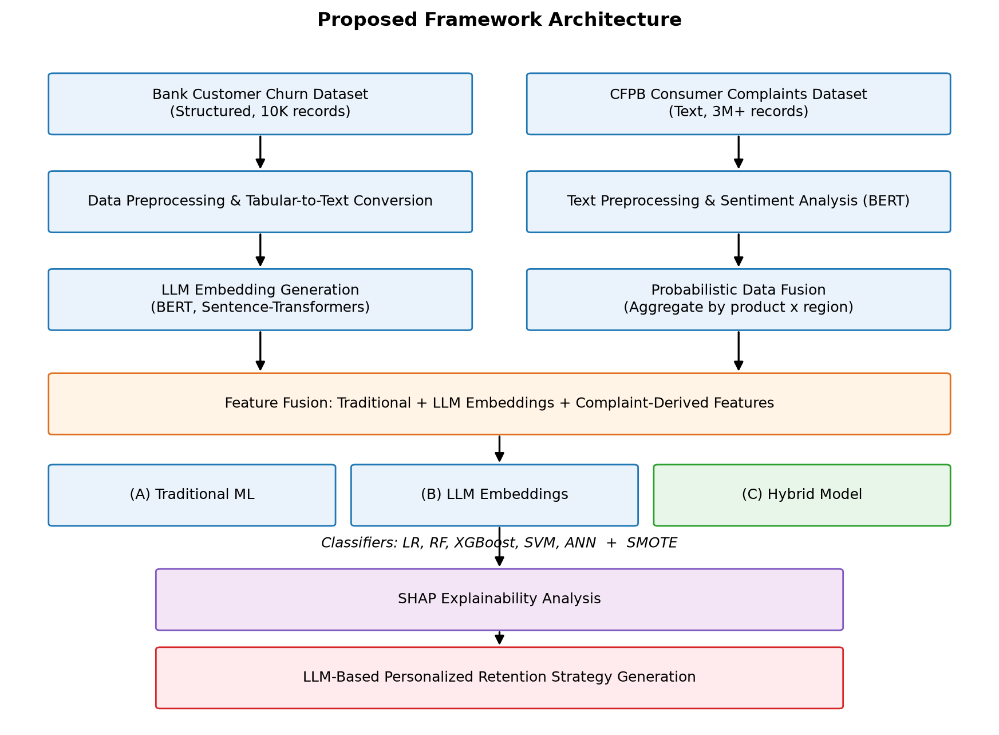
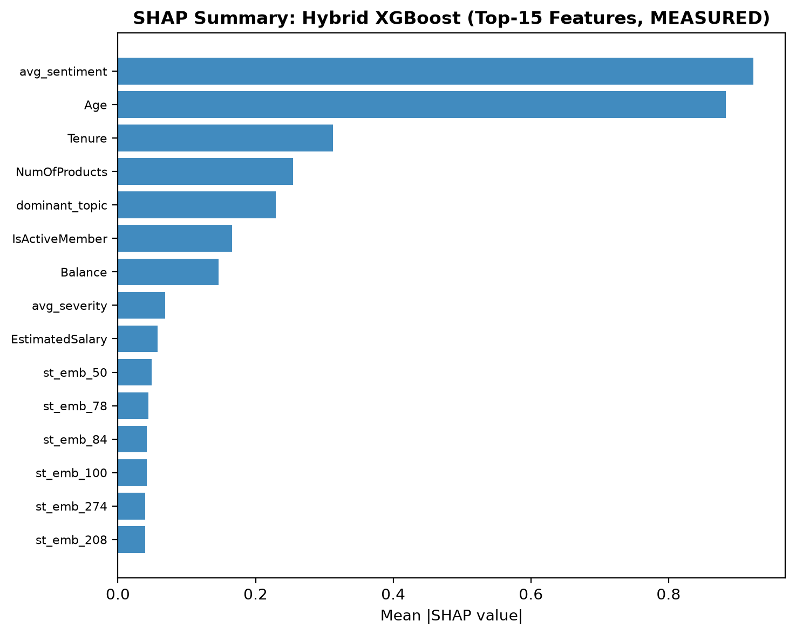

# Explainable LLM-Enhanced Churn Prediction for Retail Banking

Research code for an M.Sc. CSIT dissertation at Far Western University, Nepal.

The project asks a narrow question: **if you add language-model features to an
ordinary tabular churn model, does it actually predict better?** The answer here
is mostly no, and the repository is organised so that anyone can check that for
themselves.

Three model configurations are trained on identical cross-validation folds and
compared with paired statistical tests. SHAP explains the strongest model. The
customers it flags are then passed to an LLM that drafts a retention message
grounded in that customer's own SHAP drivers.

---

## What is in here

| | |
|---|---|
| `code/` | Importable modules — preprocessing, embeddings, complaint features, fusion, classifiers, SHAP, retention generation |
| `scripts/` | One entry point per pipeline stage; each writes a CSV under `data/processed/` |
| `notebooks/` | Stage-by-stage walkthrough, plus `00_colab_pipeline.ipynb` for the GPU stages |
| `figures/` | Figures as reported (CPU runs) |
| `figures_colab/` | The same figures from the GPU run |
| `data/processed/` | Every result table behind the reported numbers (committed; small CSVs) |
| `data/README.md` | Dataset provenance and how to fetch the raw data |

Raw datasets are **not** committed — they total roughly 8.5 GB and the largest
is refreshed daily at source. `scripts/download_data.sh` fetches them.

## The three configurations

| | Features | Purpose |
|---|---|---|
| **A** — traditional | Bank tabular attributes only | Baseline |
| **B** — LLM-only | Sentence-Transformer embeddings of each row serialised to text | Do embeddings alone carry the signal? |
| **C** — hybrid | Tabular + embeddings + complaint sentiment and topic features | Does adding language help the baseline? |

Complaint features come from the CFPB Consumer Complaint Database, joined to the
bank customers at product-and-region level, since no customer-level link exists
between the two sources. That coarse join is the main internal limitation.

## Results

Best classifier per configuration, 5-fold cross-validation, seeds 42 / 123 / 2024
(`data/processed/table_4_6.csv`):

| Config | Model | Accuracy | F1 | ROC-AUC | MCC |
|---|---|---|---|---|---|
| A — traditional | Random Forest | 0.827 | **0.608** | **0.859** | 0.500 |
| B — LLM-only | Logistic Regression | 0.764 | 0.550 | 0.822 | 0.419 |
| C — hybrid | XGBoost | **0.851** | 0.599 | 0.844 | **0.512** |

**The configurations are not statistically separable on this dataset.**
Comparing A against C over identical folds
(`data/processed/table_4_7_paired.csv`): paired *t* on per-fold F1 gives
t = −1.158 (p = 0.311); Wilcoxon signed-rank gives W = 4.0 (p = 0.438);
McNemar on held-out predictions gives χ² = 5.408 (p = 0.020), which would pass an
uncorrected 0.05 threshold but does not survive Benjamini–Hochberg correction
across the three tests. The hybrid model trades recall for precision rather than
being uniformly better.

**Complaint sentiment is the single strongest driver** in the hybrid model —
mean |SHAP| of 0.923, ahead of Age at 0.883
(`data/processed/shap_top_hybrid.csv`). The individual embedding dimensions rank
far below both. So the language signal that matters is the engineered sentiment
feature, not the 384-dimensional embedding.

**Out-of-distribution check.** Transferred unmodified to the Kaggle Playground
S4E1 bank-churn data (165,034 rows), the model reaches accuracy 0.620,
F1 0.474, ROC-AUC 0.790, with recall rising to 0.812
(`data/processed/ood_metrics.csv`). It keeps finding churners and loses
precision.





## Retention message generation

For held-out customers scored at or above a churn probability of 0.7, the
pipeline builds a profile, attaches that customer's top SHAP drivers, and asks a
language model (`gemini-3.1-flash-lite`) for a short retention message. A
rule-based generic message is produced alongside each one as a control.
50 profiles with both message variants are in
`data/processed/retention_messages.csv`, prompts included.

The 0.7 cut-off is a practical choice, not a calibrated or externally sourced
one, and it is recorded as a limitation rather than a finding.

**The human evaluation is not done.** Rating sheets for four raters are
prepared and blinded (`data/processed/retention_eval_long.csv`,
`rating_key.csv`) but every score cell is empty, so no message-quality numbers
are claimed anywhere. `scripts/score_retention_eval.py` computes the table once
real ratings exist. Placeholder Likert values that once filled this gap were
removed as fabricated, and `scripts/make_figures.py` now refuses to plot that
figure at all.

## Setup

Python 3.11 — the pinned `numpy` / `scikit-learn` / `xgboost` wheels have no
build for 3.12 or later.

```bash
git clone https://github.com/palniraj/llm-churn-banking.git
cd llm-churn-banking
python3.11 -m venv .venv && . .venv/bin/activate
pip install -r requirements.txt
```

`requirements.txt` includes torch, transformers and sentence-transformers, which
are only needed for the embedding and sentiment stages. For the CPU-measured
results alone, this is enough:

```bash
pip install numpy==1.26.4 pandas==2.2.2 scipy==1.13.1 scikit-learn==1.4.2 \
            imbalanced-learn==0.12.3 xgboost==2.0.3 joblib==1.4.2 \
            pyarrow==16.1.0 shap==0.45.1
```

Then fetch the data (needs a Kaggle API token in `~/.kaggle/`):

```bash
./scripts/download_data.sh
```

Retention generation needs an API key. Copy `.env.example` to `.env` and fill in
whichever provider you intend to use; nothing else in the pipeline requires one.

## Reproducing each result

```bash
python scripts/demo.py                     # retrains Config A live, prints the saved comparisons
python scripts/run_config_a.py             # Config A across five classifiers
python scripts/run_configs_BC.py           # Config B
python scripts/run_hybrid_light.py         # Config C (hybrid)
python scripts/run_significance_tests.py   # paired t / Wilcoxon / McNemar + BH correction
python scripts/run_shap_local.py           # SHAP rankings and plots
python scripts/run_ood_validation.py       # out-of-distribution transfer
python scripts/run_complaint_features.py   # CFPB sentiment + LDA topics
python scripts/run_retention_profiles.py   # at-risk profiles + SHAP drivers
python scripts/run_retention_generate.py   # LLM retention messages
python scripts/make_figures.py             # schematic figures
```

The GPU stages — BERT `[CLS]` embeddings and DistilBERT sentiment over 100K
complaints — are impractical on CPU. Run `notebooks/00_colab_pipeline.ipynb` on
a Colab T4 instead; `figures_colab/` holds its output.

Seeds are fixed in `code/config.py` (`RANDOM_SEEDS = (42, 123, 2024)`).

## Known limitations

- Complaints join to customers at product-and-region level, not per customer. Any
  per-customer complaint signal is therefore an aggregate proxy.
- The primary dataset is 10,000 rows, which limits the power of the paired tests.
- The 0.7 at-risk threshold is heuristic.
- Message quality is unevaluated, as described above.
- Two saved models were pickled under different scikit-learn versions (1.4.2 and
  1.9.1), so loading one under the other raises `InconsistentVersionWarning`.
  SHAP values and the confusion matrix are identical under both.

## Citation

```bibtex
@mastersthesis{pal2026churn,
  author = {Niraj Bahadur Pal},
  title  = {An Explainable LLM-Enhanced Framework for Customer Churn
            Prediction and Personalized Retention in Banking},
  school = {Far Western University},
  type   = {M.Sc. CSIT Dissertation},
  year   = {2026},
  note   = {Code: https://github.com/palniraj/llm-churn-banking}
}
```

## Licence

Code and result tables are released under the MIT Licence (see `LICENSE`).

The datasets are not covered by it and remain under their providers' terms:
Kaggle for the two bank-churn datasets, and the public domain for the CFPB
Consumer Complaint Database. See `data/README.md`.
